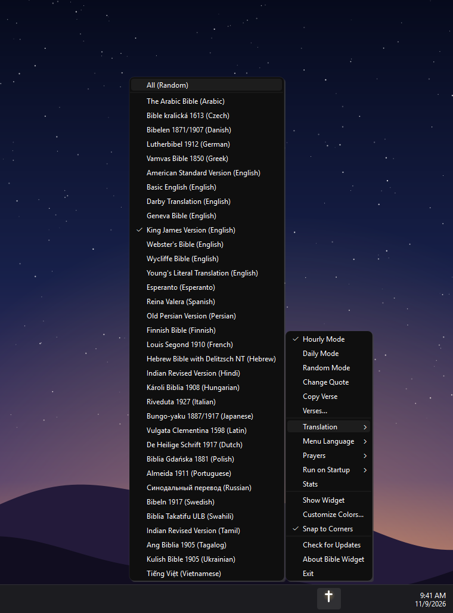
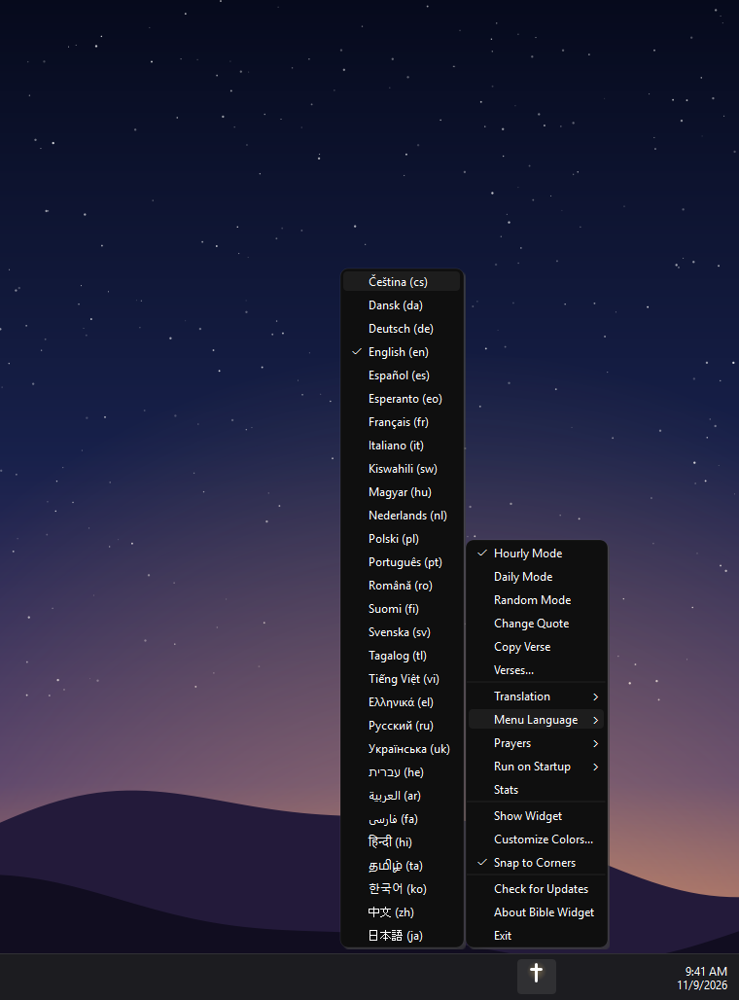
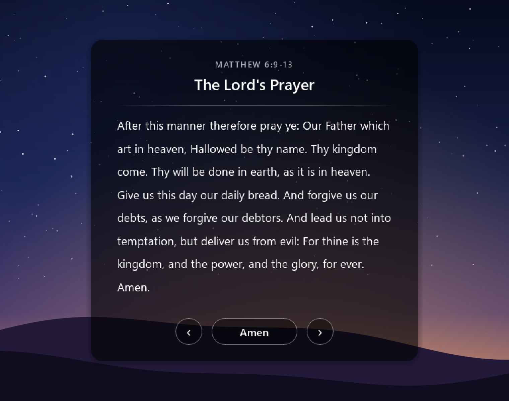
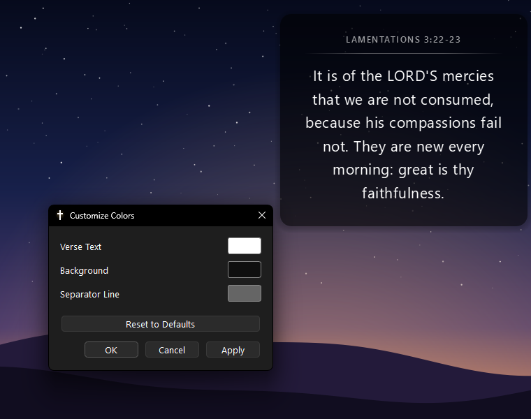
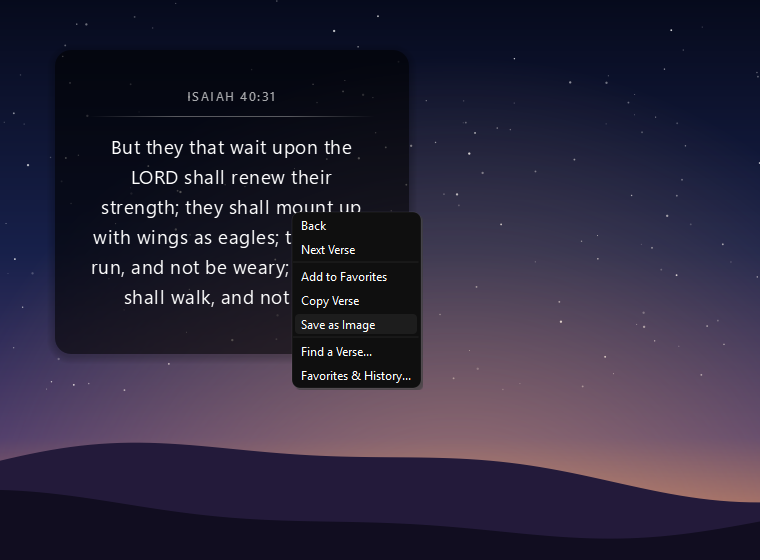
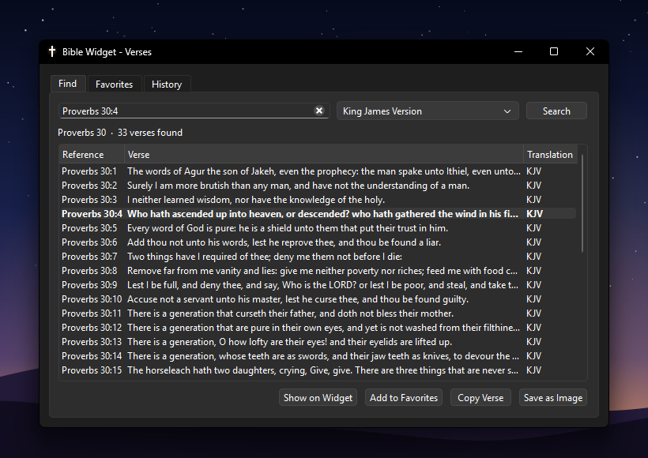

# Bible Widget

A transparent desktop widget that displays Bible verses on your screen. It sits on your desktop, stays out of the way, and gives you a new verse every hour, every 15 minutes or once a day. You can drag it anywhere, customize its colors, and it'll snap to the nearest screen corner when you let go.


| Pick from 34 translations | Menu in 29 languages |
|---|---|
|  |  |

| Prayers | Custom colors |
|---|---|
|  |  |

| Right-click the widget | Find, Favorites and History |
|---|---|
|  |  |

## A correction

Versions 1.1.0 to 2.0.2 shipped ten Bible translations we did not have the right to share, and said that every Bible in the app was public domain. That was wrong, and we are sorry, to the translators and publishers of those Bibles and to everyone who downloaded them trusting they were free to share. Version 2.1.0 removes all ten, and the old releases that contained them are taken down. Every Bible the app ships now has its license, year and source checked and listed in [LICENSE](LICENSE), and the build refuses any Bible without that record. The [CHANGELOG](CHANGELOG.md) names each one and what replaced it.

## Download

1. Download `BibleWidget-<version>-win64.zip` from the [latest release](https://github.com/puretechteam/bible-widget/releases/latest).
2. Unzip it anywhere you can write to, for example your `Documents` folder. Your settings, favorites and history are saved next to the app, so avoid `Program Files` (if the app can't save there, a notification tells you).
3. Open the `BibleWidget` folder and run `BibleWidget.exe`. Nothing else to install: no Python, no setup.

The first time, Windows SmartScreen may say "Windows protected your PC", because the app is not code-signed. Click **More info**, then **Run anyway**.

Updates install from inside the app: when a new version is out you get a notification and an **Update to...** item in the tray menu. Your settings, favorites, history and any Bibles you added are kept. If the new version fails to start, the one you had is put back automatically.

An update replaces the Bible and prayer files that come with the app, and removes the ones a new version no longer includes. If you edited one of them, your version is kept next to it as `<name>.edited-<date>`. Files you added yourself are never touched, even if a later version ships a file with the same name.

### Coming from version 2.0.2

Version 2.0.2 ran from source with Python; from 2.1.0 on there is a download to unzip. To keep your settings:

1. Exit the old widget (tray menu → Exit).
2. Copy `colors.txt`, `translation.txt`, `language.txt`, `corner.txt` and `mode.txt` from the old folder into the new `BibleWidget` folder, next to `BibleWidget.exe`. Any that are missing are settings you never changed.
3. Run `BibleWidget.exe`. If you used Run on Startup, turn it on again in the tray menu, so it starts the new version.

While the old version is still running, the new one brings it forward instead of starting a second widget.

## Features

- **Transparent overlay**: blends into your desktop, just shows the verse
- **Drag anywhere**: click and drag to move it; release and it snaps to the nearest screen corner
- **Smart corner snap**: the widget smoothly animates to the closest corner (top-left, top-right, bottom-left, or bottom-right) with a 20px margin
- **Snap toggle**: turn corner snapping on or off from the tray menu
- **Stays on your chosen corner**: the widget reopens in the same spot every launch, even on the same monitor if you have more than one
- **Bottom corners respect the taskbar**: the widget won't get hidden behind the taskbar
- **Color customization**: pick your own colors for the verse text, background, and separator line. Right-click the tray icon → "Customize Colors..."
- **Reset to defaults**: restore the original dark style with one click in the color settings
- **Show Widget button**: if the widget ever goes missing, click the tray icon, or right-click it → "Show Widget", to bring it back
- **Card shadow**: a soft drop shadow makes it look like a floating card on your desktop
- **Smart text fit**: the widget is sized for the screen it is on (20% of its width) and the font shrinks to fit long verses. If a passage is still too long, it is shortened by a verse or two; a single very long verse makes the widget taller just for that verse, and on a small screen wider too, so the whole verse always shows
- **34 Bible translations in 27 languages**: Arabic, Czech, Danish, Dutch, English (×8), Esperanto, Finnish, French, German, Greek, Hebrew, Hindi, Hungarian, Italian, Japanese, Latin, Persian, Polish, Portuguese, Russian, Spanish, Swahili, Swedish, Tagalog, Tamil, Ukrainian, Vietnamese. Every one is public domain or under CC BY-SA 4.0. Each one's source and copyright status is listed under License
- **Menu Language picker**: right-click the tray icon to change the tray menu text to any of 29 languages, independent from your Bible translation. Arabic, Hebrew and Persian menus and windows read from right to left. Language names come from Unicode CLDR, and OK, Cancel, Apply, Close and Reset to Defaults from Qt's own translations (in the 20 menu languages Qt covers); the rest of the menu text in languages other than English is machine translated (Menu Language has a link to suggest a better wording)
- **Prayers**: right-click the tray icon → Prayers → choose from 6 prayers (The Lord's Prayer, Jonah's Prayer, Mary's Magnificat, Job's Prayer, Acts 4:24-26, Solomon's Prayer) with prev/next navigation, scrollable text, and Amen button (arrow keys switch prayers, Esc closes). It opens on the widget's screen
- **Hourly mode**: shows a random passage every hour
- **Daily mode**: shows the same verse all day (changes at midnight)
- **Random mode**: a new random passage every 15 minutes
- **Native book names**: references use the book names of the translation's language
- **Copy Verse**: right-click the tray icon → Copy Verse to copy the current text and reference, with the translation (John 11:35 (KJV)), to your clipboard
- **Stats**: right-click the tray icon → Stats to see the current translation, uptime, verse count, mode, and next refresh in a popup (no terminal needed)
- **Change Quote**: instantly get a new verse from the tray menu
- **Run on Startup**: turn it on or off in the tray menu (running from source also offers With console, which shows live stats). If you move or rename the folder, the startup entry is repaired the next time you open the widget. If it still starts another copy (an older version, say), it shows as off, and choosing Off leaves it alone; turning it on makes it start this one.
- **One copy at a time**: launching it again just brings the running widget forward, even if that is an older version
- **Error log**: if anything goes wrong it is written to `widget.log`, crashes included: if the widget ever ends without being closed, the next start writes down when it was last seen running, its memory use, where it crashed and Windows' own crash report for it. Please attach `widget.log` (and `crash.log` if there is one) when you report a problem
- **Settings save automatically**: your Bible translation, menu language, refresh mode, colors, corner, and snap preference are all remembered between launches
- **Find a verse**: type a reference (John 3:16, Jn 3:16-18, Juan 3:16, 1 Cor 13, Jude 3) to see its whole chapter with your verse highlighted, or a few words to search the whole Bible, then show any result on the widget. With a chapter number, book names work in any of the Bibles' languages, and numbered books can be typed with a number whatever way the Bible writes them (1 Jana for I Jana, 1 Ιωάννου for Α' Ιωάννου). Names work with or without the words in front of them (К Римлянам, Księga Rodzaju) and in older forms (Første Kongebog, コリント前書), and English short forms (Dan 7:13, Ro 1:1) work in every Bible. A word on its own counts as a book name only in the translation's language or in English, otherwise it is searched for, and so is a book name that is mostly another word in its own Bible (the Hebrew יהודה is Judah as well as Jude). Numbers typed with a Japanese or Chinese keyboard (ヨハネ３：１６) work too. Searches find words typed the way keyboards type them: Vietnamese without accents, Japanese with modern kanji (国 finds 國), Persian without the zero-width non-joiner, Hindi with or without the zero-width joiner, any kind of apostrophe (l'Éternel finds l’Éternel), and Arabic and Persian yeh and kaf as the same letters. Open it from the tray menu (Verses...) or the widget's right-click menu
- **Favorites and History**: save verses you love, and look back at every verse the widget has shown (the last 100). Every list can show, copy or save the selected verse as an image, from its buttons or a right-click menu. Keys: Enter shows the verse, Ctrl+C copies it, Delete removes a favorite, Ctrl+F jumps to Find, Esc closes. Clear History asks first
- **Back**: right-click the widget and choose Back to bring back the verse that just changed
- **Save as Image**: turns the current verse into a card image, saved to `Pictures\Bible Widget` and copied to your clipboard, ready to paste anywhere (click the notification to open it). Every image gets its own one-of-a-kind background (starry night, aurora, sunrise, ocean, heavenly light, nebula or bokeh, each with random colors and shapes), and the verse is always kept readable
- **Right-click the widget** for quick actions: Back, Next Verse, Add to Favorites, Copy Verse, Save as Image, Find a Verse..., Favorites & History...
- **Sharp tray icon**: the cross stays crisp at every display scale and stays visible on light taskbars (it follows the taskbar's own light or dark setting)
- **Updates from inside the app**: choose Check for Updates in the tray menu, or let it check automatically (shortly after it starts, then once a day). In the downloaded app, one click installs the new version and restarts the widget; running from source opens the download page instead
- **About Bible Widget** (tray menu): shows the version, with update settings
- **Works offline**: all Bible data is included. The only time it goes online is a quick update check on GitHub (shortly after it starts, then once a day) and downloading an update you accept. The check sends no personal data and can be turned off in About Bible Widget

## Requirements

- **Windows** (10 or 11)
- The download needs nothing else. Running from source needs Python 3.9 to 3.14 and PySide6 (see below).

## Quick Start

1. Download and unzip the release (see **Download** above) and run `BibleWidget.exe`
2. The widget appears in the top-right corner of your screen
3. Right-click the widget for quick actions, or right-click the cross icon in your system tray for everything else (translations, menu language, prayers, colors, startup, updates, and more)

## Running from source

1. Install Python 3.9 or newer (up to 3.14) with "Add Python to PATH" checked
2. Run `dependencies.bat` to install the packages in `requirements.txt` (PySide6)
3. Double-click `start_widget.vbs` to launch the widget without a terminal window

To build the standalone version yourself: use Python 3.9 to 3.13 from python.org (PyInstaller 6.11 does not support 3.14 yet, and `build.py` copies the license file the python.org installer adds), run `pip install -r requirements-dev.txt`, then `python build.py`. The result is in `dist\`. The build stops if a Bible's license is not recorded, or if LICENSE names another Python or PySide6 version than the one building it.

To run the tests: `python tests/run_tests.py` (about two minutes; add a word such as `widget` to run only the matching files). They run offscreen with their files in a temp folder, so your settings, favorites, history and Pictures folder are never touched.

### Stopping the widget

- `stop_widget.bat` stops the widget, or choose Exit in the tray menu

## Files

| File | What it does |
|------|-------------|
| `BibleWidget.exe` | The app (in the download) |
| `dependencies.bat` | Installs `requirements.txt` for running from source |
| `requirements.txt` / `requirements-dev.txt` | Packages for running from source / for building the exe |
| `start_widget.vbs` | Launch widget silently (no terminal; running from source) |
| `stop_widget.bat` | Stop the widget (running from source) |
| `widget_window.py` | The main widget code |
| `prayer_window.py` | Prayer window: scrollable, cycle through 6 prayers |
| `menu_strings.py` | Tray menu text translations (29 languages) |
| `bible_loader.py` | Loads Bible data and picks verses |
| `verses.py` / `verses_window.py` | Find a verse, Favorites and History, and their window |
| `share_image.py` / `backgrounds.py` | Save as Image: the verse card and its one-of-a-kind backgrounds |
| `tray_icon.py` | The tray and app icon |
| `about_window.py` / `updater.py` | About window, update checks and in-app updates |
| `crash_log.py` | Records how the app ended (crashes, Windows shutting down) in `widget.log` |
| `selftest.py` | `BibleWidget.exe --self-test`: checks a build works |
| `tests/` | The test suite (`python tests/run_tests.py`) |
| `paths.py` / `version.py` | Where the app's files live; the version number |
| `build.py` / `BibleWidget.spec` | Builds the standalone download |
| `colors.py` | Color customization storage (reads/writes `colors.txt`) |
| `bibles/` | All 34 Bible JSON files, plus index.json (names, license, year and source of each) and book_names.json |
| `screenshots/` | The pictures in this README (also in the download) |
| `prayers/` | 6 prayers in all 34 translations (prayers.json) |
| `licenses/` | License texts of the software the download is built with (Qt, PySide6, and the third-party code inside Qt; Python's is added by `build.py`) and of the CLDR language names |
| `translation.txt` | Saved Bible translation preference |
| `language.txt` | Saved menu language preference |
| `colors.txt` | Saved color preferences |
| `corner.txt` | Saved screen corner, monitor, Snap to Corners setting and, with snapping off, the widget's position |
| `mode.txt` | Saved refresh mode (hourly, daily, random) |
| `favorites.json` / `history.json` | Your saved verses and recent verses |
| `updates.txt` | Update settings (automatic checks on or off, skipped version) |
| `widget.log` / `update.log` | Error and status log / log of installed updates |
| `crash.log` | Where a fatal error inside the app is written as it happens (copied into `widget.log` at the next start, then emptied) |
| `widget.pid` | The running widget's process number, and when it was last seen running (every 10 minutes) |

## Known Issues

- **SmartScreen warning on first run**: the exe is not code-signed, so Windows may show "Windows protected your PC". Choose More info, then Run anyway.

## How It Works

The widget loads only the translation it needs, keeping a few recent ones cached, so memory use stays low even with all 34 installed. Each time a new verse is requested, it picks a random book, chapter, and starting verse, then grabs 1-5 consecutive verses. The font shrinks to keep the widget at a fixed size: long passages get smaller text and short ones larger text. If a passage still does not fit, its last verses are dropped, and a single very long verse makes the widget slightly taller for that verse only.

When you drag the widget and release, it calculates which of the four screen corners is closest and animates to that corner with a 200ms ease-out animation. The corner choice is saved so the widget reopens in the same spot every time. If you have multiple monitors, the specific monitor is also saved: if you disconnect that monitor, the widget falls back to your primary monitor.

The widget sits at the bottom of the window stack like a desktop gadget. When the desktop itself is in focus (for example after Win+D), it rises above it so it stays visible.

In daily mode, the verse is seeded by the current date, so everyone reading the same translation gets the same verse on the same day.

The tray menu can be displayed in any of 29 languages, independent from which Bible translation you're reading.

## Adding a New Translation

Place a Bible JSON file in the `bibles/` folder. The widget auto-discovers it on next launch.

To add one to Bible Widget itself, it must be free to share: public domain (check its history, not only the site you got it from) or under CC BY-SA 4.0. Its entry in `bibles/index.json` needs a `license`, `year` and `source`, and it must be listed in LICENSE; the build and the tests refuse a Bible without them. The file should follow one of these formats:

**Standard format (most Bibles):**
```json
{
  "Genesis": {
    "1": {
      "1": "In the beginning...",
      "2": "And the earth..."
    }
  }
}
```

**Array format (like the Arabic Bible):**
```json
[
  {
    "name": "Genesis",
    "chapters": [
      ["In the beginning...", "And the earth..."],
      [...]
    ]
  }
]
```

If you add a new file, also add its info to `bibles/index.json` for proper display names (updates keep your entries):
```json
{
  "language": "English",
  "versions": [
    { "name": "My Translation", "abbreviation": "my_trans",
      "license": "Public Domain", "year": "1901", "source": "https://..." }
  ]
}
```

## Adding a New Menu Language

Add a new entry to `LANGUAGES` in `menu_strings.py` with the 2-letter language code and all translated menu strings, and a column for it in `_LANGUAGE_NAMES`, taking the language names from Unicode CLDR (https://cldr.unicode.org) rather than translating them. Machine translations are welcome only as a start: say so in the pull request, so a native speaker can review them. Add the language's English name to `MENU_LANGUAGE_ENGLISH` (menu text names Bible books in that language through it), and if Qt ships a translation for it (a `qtbase_<code>.qm` file), its locale to `_QT_LOCALES`, so OK, Cancel and the other standard buttons use Qt's wording. For a language written right to left, also add its code to `RTL_MENU_LANGUAGES` in `widget_window.py`.

## License

<a href="https://github.com/puretechteam/bible-widget">Bible Widget</a> by <a href="https://github.com/puretechteam">Pure Tech</a> is marked <a href="https://creativecommons.org/publicdomain/zero/1.0/">CC0 1.0 Universal</a>

The CC0 mark covers the app itself. The Bible texts keep their own status: 30 are public domain and 4 (the Hindi and Tamil Indian Revised Version, the Swahili Unlocked Literal Bible and the Wycliffe transcription) are under CC BY-SA 4.0. [LICENSE](LICENSE) lists each one with its source, along with the licenses of the language names (Unicode CLDR) and of the software in the download (Python, Qt, PySide6).
