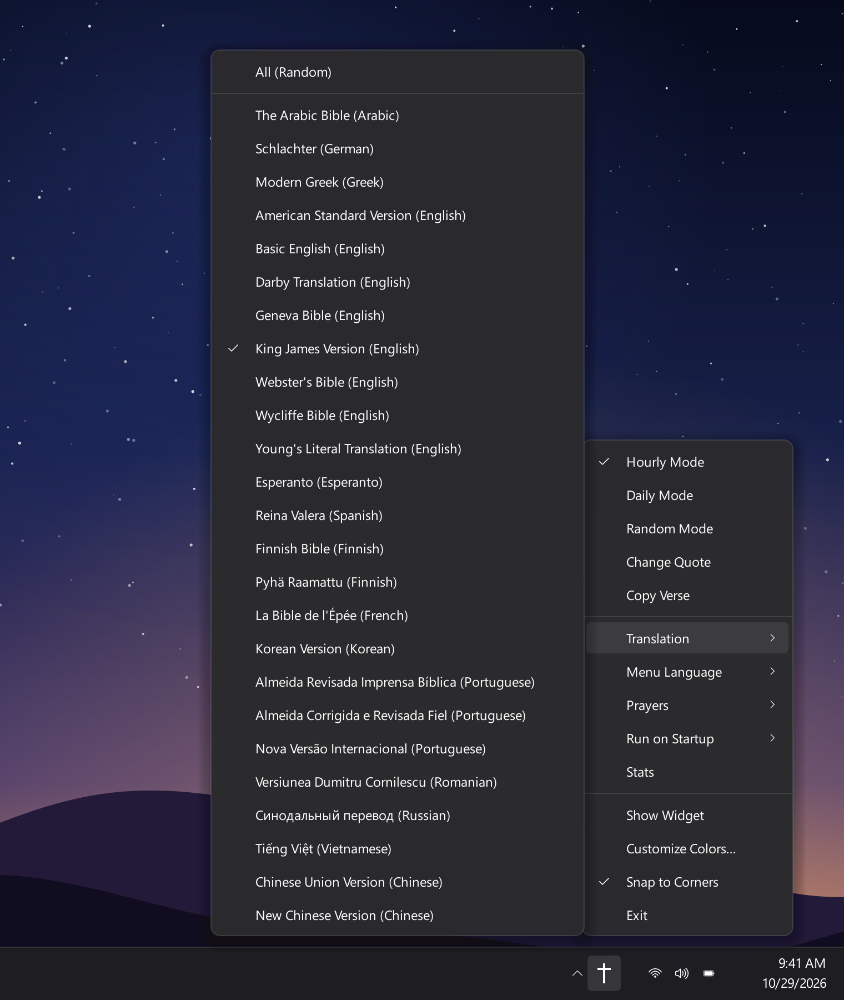
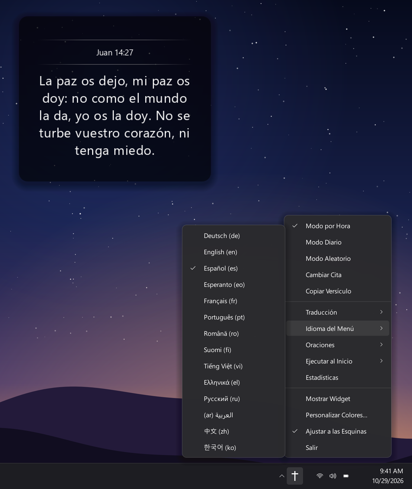
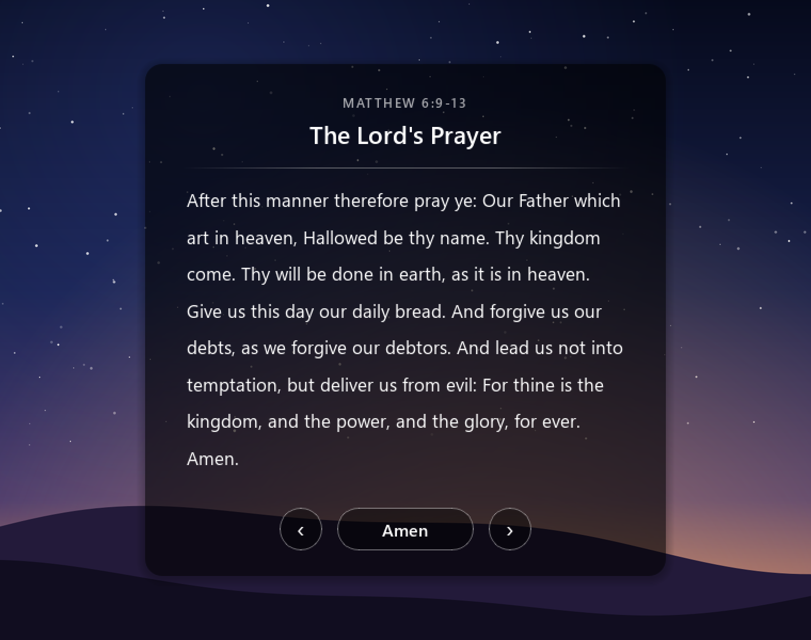
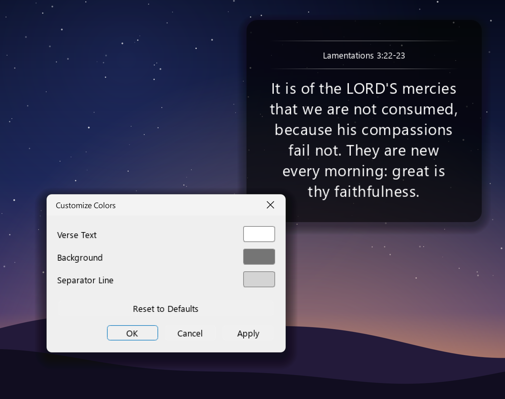

# Bible Widget

A transparent desktop widget that displays Bible verses on your screen. It sits on your desktop, stays out of the way, and gives you a new verse every hour (or daily if you prefer). You can drag it anywhere, customize its colors, and it'll snap to the nearest screen corner when you let go.


| Pick from 25 translations | Menu in 14 languages |
|---|---|
|  |  |

| Prayers | Custom colors |
|---|---|
|  |  |

## Features

- **Transparent overlay** — blends into your desktop, just shows the verse
- **Drag anywhere** — click and drag to move it; release and it snaps to the nearest screen corner
- **Smart corner snap** — the widget smoothly animates to the closest corner (top-left, top-right, bottom-left, or bottom-right) with a 20px margin
- **Snap toggle** — turn corner snapping on or off from the tray menu
- **Stays on your chosen corner** — the widget reopens in the same spot every launch, even on the same monitor if you have more than one
- **Bottom corners respect the taskbar** — the widget won't get hidden behind the taskbar
- **Color customization** — pick your own colors for the verse text, background, and separator line. Right-click the tray icon → "Customize Colors..."
- **Reset to defaults** — restore the original dark style with one click in the color settings
- **Show Widget button** — if the widget ever goes missing, right-click the tray icon → "Show Widget" to bring it back
- **Card shadow** — a soft drop shadow makes it look like a floating card on your desktop
- **Smart text fit** — the widget keeps a constant size; when a verse is long, the font shrinks to fit instead of stretching the window
- **25 Bible translations** — 14 languages: Arabic, Chinese (×2), German, Greek, English (×8), Esperanto, Spanish, Finnish (×2), French, Korean, Portuguese (×3), Romanian, Russian, Vietnamese
- **Menu Language picker** — right-click the tray icon to change the tray menu text to any of 14 languages, independent from your Bible translation
- **Prayers** — right-click the tray icon → Prayers → choose from 6 prayers (The Lord's Prayer, Jonah's Prayer, Mary's Magnificat, Job's Prayer, Acts 4:24-26, Solomon's Prayer) with prev/next navigation, scrollable text, and Amen button
- **Hourly mode** — shows a random passage every hour
- **Daily mode** — shows the same verse all day (changes at midnight)
- **Random mode**: a new random passage every 15 minutes
- **Native book names**: references use the book names of the translation's language
- **Copy Verse** — right-click the tray icon → Copy Verse to copy the current reference and text to your clipboard
- **Stats** — right-click the tray icon → Stats to see the current translation, uptime, verse count, mode, and next refresh in a popup (no terminal needed)
- **Change Quote** — instantly get a new verse from the tray menu
- **Run on Startup**: choose Off, Silent, or With console (shows live stats) in the tray menu. Survives folder renames, no broken paths.
- **One copy at a time**: launching it again just brings the running widget forward
- **Error log**: if anything goes wrong it is written to `widget.log`
- **Settings save automatically** — your Bible translation, menu language, refresh mode, colors, corner, and snap preference are all remembered between launches
- **Works offline** — all Bible data bundled locally, no internet needed after setup

## Requirements

- **Windows** (10 or 11)
- **Python 3.8+** installed with "Add Python to PATH" checked
- **PySide6** (run `dependencies.bat` to install it automatically)

## Quick Start

1. Run `dependencies.bat` — this installs PySide6 if you don't have it
2. Double-click `start_widget.vbs` to launch the widget (no terminal window)
3. The widget appears in the top-right corner of your screen
4. Right-click the cross icon in your system tray to access all options (change verse, pick translation, change menu language, open prayers, customize colors, toggle snap, view stats, bring the widget back, or exit)

### Alternative launch

- `stop_widget.bat` — kills the widget if needed

## Files

| File | What it does |
|------|-------------|
| `dependencies.bat` | Check/install PySide6 |
| `start_widget.vbs` | Launch widget silently (no terminal) |
| `stop_widget.bat` | Stop the widget |
| `widget_window.py` | The main widget code |
| `prayer_window.py` | Prayer overlay window — scrollable, cycle through 6 prayers |
| `menu_strings.py` | Tray menu text translations (14 languages) |
| `bible_loader.py` | Loads Bible data and picks verses |
| `colors.py` | Color customization storage (reads/writes `colors.txt`) |
| `bibles/` | All 25 Bible JSON files + index.json (~100 MB) |
| `prayers/` | 6 prayers in all 25 translations (prayers.json) |
| `translation.txt` | Saved Bible translation preference |
| `language.txt` | Saved menu language preference |
| `colors.txt` | Saved color preferences |
| `corner.txt` | Saved screen corner and monitor |
| `mode.txt` | Saved refresh mode (hourly, daily, random) |
| `widget.log` | Error and status log |
| `bibles/book_names.json` | Native book names per language |

## Known Issues

- **New Chinese Version section headings**: some verses in `zh_ncv` start with a section heading glued onto the verse text (this is in the source data).

## How It Works

The widget loads only the translation it needs, keeping a few recent ones cached, so memory use stays low even with all 25 installed. Each time a new verse is requested, it picks a random book, chapter, and starting verse, then grabs 1-5 consecutive verses. The font automatically shrinks to keep the widget at a fixed size — long verses get smaller text, short verses get larger text.

When you drag the widget and release, it calculates which of the four screen corners is closest and animates to that corner with a 200ms ease-out animation. The corner choice is saved so the widget reopens in the same spot every time. If you have multiple monitors, the specific monitor is also saved — if you disconnect that monitor, the widget falls back to your primary monitor.

The widget sits at the bottom of the window stack like a desktop gadget. When the desktop itself is in focus (for example after Win+D), it rises above it so it stays visible.

In daily mode, the verse is seeded by the current date so everyone gets the same verse on the same day.

The tray menu can be displayed in any of 14 languages, independent from which Bible translation you're reading.

## Adding a New Translation

Place a Bible JSON file in the `bibles/` folder. The widget auto-discovers it on next launch. The file should follow one of these formats:

**Standard format (most Bibles):**
```json
{
  "Genesis": {
    "1": {
      "1": "In the beginning...",
      "2": "And the earth..."
    }
  }
}
```

**Array format (like the Arabic Bible):**
```json
[
  {
    "name": "Genesis",
    "chapters": [
      ["In the beginning...", "And the earth..."],
      [...]
    ]
  }
]
```

If you add a new file, also add its info to `bibles/index.json` for proper display names:
```json
{
  "language": "English",
  "versions": [
    { "name": "My Translation", "abbreviation": "my_trans" }
  ]
}
```

## Adding a New Menu Language

Add a new entry to `LANGUAGES` in `menu_strings.py` with the 2-letter language code and all translated menu strings.

## License

<a href="https://github.com/puretechteam/bible-widget">Bible Widget</a> by <a href="https://github.com/puretechteam">Pure Tech</a> is marked <a href="https://creativecommons.org/publicdomain/zero/1.0/">CC0 1.0 Universal</a>

All Bible texts are public domain. JSON data sourced from [thiagobodruk/bible](https://github.com/thiagobodruk/bible) (CC0).
